<div align="center">



<br>

<a href="mailto:ddaydechdecho@gmail.com">อีเมล</a> &nbsp;|&nbsp;
<a href="https://twitter.com/Dechdecho_dday">X @Dechdecho_dday</a> &nbsp;|&nbsp;
<a href="https://instagram.com/dxday_.dxch">Instagram @dxday_.dxch</a> &nbsp;|&nbsp;
<a href="https://github.com/Daradeeday?tab=repositories">ดูรีโปทั้งหมด (28)</a>

</div>

<br>

ผมชอบของที่ทำงานได้จริง ไม่ว่ามันจะอยู่บนหน้าจอ บนบอร์ด Arduino หรือในฉาก Blender
บางวันเขียน React บางวันนั่งต่อสาย และบางวันก็นั่งจัดขอบปุ่มใน Figma ไปสามชั่วโมง

ส่วนด้านล่างกดเปิดดูได้ทุกอัน

<br>

<details>
<summary><b>เครื่องมือที่ใช้ (แบ่งตามงาน)</b></summary>

<br>

| งาน | ของที่หยิบมาใช้ |
|:--|:--|
| **หน้าเว็บ** | HTML, CSS, JavaScript, TypeScript, React, PHP |
| **หลังบ้าน** | Node.js, Firebase |
| **แอปมือถือ** | Flutter |
| **ของที่จับต้องได้** | Arduino, C, C++ |
| **ภาพและโมเดล** | Figma, Adobe XD, Illustrator, Photoshop, Blender |
| **มองเห็นด้วยโค้ด** | OpenCV, Python |
| **ใช้ทุกวัน** | Git, Linux, Java |

</details>

<details>
<summary><b>งานที่เปิดให้ดู</b></summary>

<br>

| รีโป | ภาษา | ลิงก์ |
|:--|:--|:--|
| tnsmusic | TypeScript | [เปิดดู](https://github.com/Daradeeday/tnsmusic) |
| Sapar-Tns | HTML | [เปิดดู](https://github.com/Daradeeday/Sapar-Tns) |
| Wanmai.github.io | HTML | [เปิดดู](https://github.com/Daradeeday/Wanmai.github.io) |
| Daradeeday.github.io | HTML | [เปิดดู](https://github.com/Daradeeday/Daradeeday.github.io) |
| hello | TypeScript | [เปิดดู](https://github.com/Daradeeday/hello) |

<!-- เติมคำอธิบายสั้นๆ ของแต่ละงานเป็นคอลัมน์ใหม่ได้ เช่น "เว็บเพลงของโรงเรียน" -->

</details>

<details>
<summary><b>git log ของคนที่คิดว่าตัวเองตลกตอนเขียนโค้ด</b></summary>

<br>

```text
a41f9c2  fix: แก้บั๊กที่ตัวเองสร้างเมื่อเมื่อวาน
7be03d8  feat: เพิ่มปุ่มที่ไม่มีใครขอ แต่ดูดี
c92a1e0  refactor: ย้ายโค้ดไปมา ผลลัพธ์เหมือนเดิมทุกอย่าง
5d7720b  chore: ลบคอมเมนต์ "อย่าแตะส่วนนี้" แล้วแตะมันทันที
e108bb4  fix: ใส่ semicolon ที่หายไป (หาอยู่สี่สิบนาที)
0000000  init: ทุกอย่างเริ่มจากคำว่า hello
```

</details>

<details>
<summary><b>ปุ่มลับ</b></summary>

<br>

```text
   ┌──────────┐
 ──┤  D A Y   ├──   ถ้าเห็นข้อความนี้ แปลว่าคุณกดทุกปุ่มจริงๆ
 ──┤          ├──   ทักมาคุยกันได้เลย ddaydechdecho@gmail.com
   └──────────┘
```

</details>

<br>

<div align="center">

<a href="https://github.com/Daradeeday?tab=achievements&achievement=pull-shark">
  
</a>
&nbsp;
<a href="https://github.com/Daradeeday?tab=achievements&achievement=pair-extraordinaire">
  
</a>

</div>
